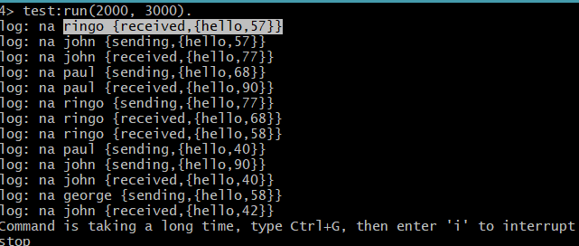

```
log: na ringo {received,{hello,57}}
log: na john {sending,{hello,57}}
```
* `john` sends to `ringo`, but ringo logs the `received` event, before john logs the `sending` event (happens because john jitters before logging its event).

```
log: na john {received,{hello,77}}
log: na ringo {sending,{hello,77}}
```
* `ringo` sends to `john`, but john logs the `received` event, before ringo logs the `sending` event (happens because ringo jitters before logging its event).

```
log: na paul {sending,{hello,68}}
log: na ringo {received,{hello,68}}
```
* `paul` sends to `ringo`, and the logging order is correct (probably because ringo was processing another message and thus paul had enough time to log its own event first).

```
log: na paul {received,{hello,90}}
log: na john {sending,{hello,90}}
```
* `john` sends to `paul`, but paul logs the `received` event, before john logs the `sending` event (happens because john jitters before logging its event).

```
log: na ringo {received,{hello,58}}
log: na george {sending,{hello,58}}
```
* `george` sends to `ringo`, but ringo logs the `received` event, before george logs the `sending` event (happens because george jitters before logging its event).

```
log: na paul {sending,{hello,40}}
log: na john {received,{hello,40}}
```
* `paul` sends to `john`, and the logging order is correct (probably because john was processing another message and thus paul had enough time to log its own event first)