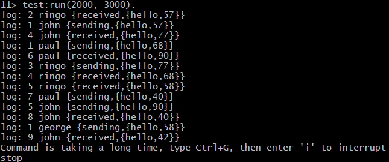

# Test runs of test.erl with workers that use Lamport counters

## Test Run with 3000 jitter



```
log: 2 ringo {received,{hello,57}}
log: 1 john {sending,{hello,57}}
```
* `john` sends to `ringo` (increasing john's Lamport counter by 1 (0 -> 1)), and ringo computes `max(0, 1) + 1 -> 2`, but ringo logs the `received` event, before john logs the `sending` event. By examining the Lamport counters, we can conclude that the order is wrong, since event '2' is logged before event '1'.

```
log: 4 john {received,{hello,77}}
log: 3 ringo {sending,{hello,77}}
```
* `ringo` sends to `john` (increasing ringo's Lamport counter by 1 (2 -> 3)), and john computes `max(1, 3) + 1 -> 4`, but john logs the `received` event, before ringo logs the `sending` event. By examining the Lamport counters, we can conclude that the order is wrong, since event '4' is logged before event '3'.

```
log: 1 paul {sending,{hello,68}}
log: 4 ringo {received,{hello,68}}
```
* `paul` sends to `ringo` (increasing paul's Lamport counter by 1 (0 -> 1)), and ringo computes `max(3, 1) + 1 -> 4`, and the logging order is correct. We can see that the Lamport counter '1' is logged before counter '4'.

```
log: 6 paul {received,{hello,90}}
log: 5 john {sending,{hello,90}}
```
* `john` sends to `paul` (increasing john's Lamport counter by 1 (4 -> 5)), and paul computes `max(1, 5) + 1 -> 6`, but paul logs the `received` event, before john logs the `sending` event. By examining the Lamport counters, we can conclude that the order is wrong, since event '6' is logged before event '5'.

```
log: 5 ringo {received,{hello,58}}
log: 1 george {sending,{hello,58}}
```
* `george` sends to `ringo` (increasing george's Lamport counter by 1 (0 -> 1)), and ringo computes `max(4, 1) + 1 -> 5`, but ringo logs the `received` event, before george logs the `sending` event. By examining the Lamport counters, we can conclude that the order is wrong, since event '5' is logged before event '1'.

```
log: 7 paul {sending,{hello,40}}
log: 8 john {received,{hello,40}}
```
* `paul` sends to `john` (increasing paul's Lamport counter by 1 (6 -> 7)), and john computes `max(5, 7) + 1 -> 8`, and the logging order is correct. We can see that the Lamport counter '7' is logged before counter '8'.

### What is always true?
* For all events in the same process, we have `LamportCounter(ei) < LamportCounter(ej)` if event `ei` happened before event `ej`
    * Example: All events of john can be ordered by john's Lamport counter (1 -> 4 -> 5 -> 8) and we can be sure that the event with the counter 4 happened before the event with the counter 5 (the reverse is true as well: if `X` happens before `Y`, we will have `LamportCounter(X) < LamportCounter(Y)`).
* For message events (related) between two processes, if an event `X` happened before event `Y`, we will have `LamportCounter(X) < LamportCounter(Y)`

    * Example: All `sending` events have a lower Lamport counter than the respective `received` events (for the same message of course). This is because the `sending` event triggers/causes the `received` event, and thus it will always happen before it. This of course also means that a `sending` event happens before any events after the corresponding `received` event (example: `sending` event of john with `LamportCounter=1` happened before paul's `sending` event with `LamportCounter=3`, since the latter event happened after the `received` event, which we already know happened after the original `sending` event of john - this is supported by the counters as 1 < 3).

### What is sometimes true?
* In different processes, if we have event `X` in process A and event `Y` in process B (without a relation between the events - e.g. no message passing), with `LamportCounter(X) < LamportCounter(Y)`, it does not necessarily mean that X happened before Y. These events are considered concurrent (even though they might have not happened at the same time).


### How do we play it safe?
* If no relation exists between two events in different processes (e.g. `sent` and `received` message), never make any conclusion for their ordering based on their Lamport counters and consider them concurrent.


#### Good Lamport clock explanation: https://singhajit.com/distributed-systems/lamport-clock/