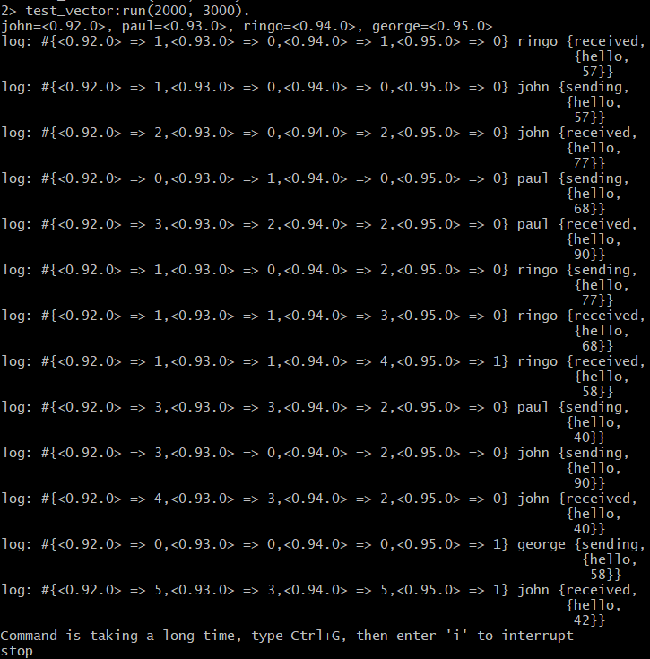

# Test runs of test_vector.erl with workers that use Vector clocks

## Test Run with 3000 jitter



```
2> test_vector:run(100, 3000).
john=<0.92.0>, paul=<0.93.0>, ringo=<0.94.0>, george=<0.95.0>
```

Vector positions, in order, are `{john, paul, ringo, george}`.

```
log: #{john => 0, paul => 0, ringo => 0, george => 1} george {sending,{hello,58}}
log: #{john => 0, paul => 1, ringo => 0, george => 0} paul   {sending,{hello,68}}
log: #{john => 1, paul => 0, ringo => 0, george => 0} john   {sending,{hello,57}}
log: #{john => 1, paul => 0, ringo => 1, george => 0} ringo  {received,{hello,57}}
log: #{john => 1, paul => 0, ringo => 2, george => 0} ringo  {sending,{hello,77}}
log: #{john => 1, paul => 1, ringo => 3, george => 0} ringo  {received,{hello,68}}
log: #{john => 1, paul => 1, ringo => 4, george => 1} ringo  {received,{hello,58}}
log: #{john => 1, paul => 1, ringo => 5, george => 1} ringo  {sending,{hello,42}}

Command is taking a long time, type Ctrl+G, then enter 'i' to interrupt
Maximum holdback queue size: 18
stop
```

* `john` sends to `ringo` (`{1,0,0,0}`). On receipt, `ringo` first increments its own entry, `{0,0,0,0} -> {0,0,1,0}`, then merges with john's vector by taking the max of each entry, `{0,0,1,0}` and `{1,0,0,0} -> {1,0,1,0}` for the `received` event. The `sending` event (`{1,0,0,0}`) is printed before the `received` event (`{1,0,1,0}`), and every entry of the first is `<=` the matching entry of the second, so this confirms `sending -> received`.

* `paul` sends to `ringo` (`{0,1,0,0}`). Before this, `ringo` had already logged its own `sending` event for message 77 with vector `{1,0,2,0}`. When `ringo` receives paul's message, it increments its own entry again, `{1,0,2,0} -> {1,0,3,0}`, then merges with paul's vector, `{1,0,3,0}` and `{0,1,0,0} -> {1,1,3,0}` for the `received` event. The `sending` event from `paul` is printed before this `received` event, and every entry of `paul`'s vector (`{0,1,0,0}`) is `<=` the matching entry of `{1,1,3,0}`, so this confirms `sending -> received`.

* `george` sends to `ringo` (`{0,0,0,1}`), and `ringo`'s corresponding `received` event is `{1,1,4,1}`. Every entry of `{0,0,0,1}` is `<=` the matching entry of `{1,1,4,1}`, so again `sending -> received`, and the logging order is correct.

* `ringo`'s own events (`received 57 -> sending 77 -> received 68 -> received 58 -> sending 42`) are all on the same process, so `ringo`'s own entry strictly increases across them (`0 -> 1 -> 2 -> 3 -> 4 -> 5`), and each event's vector is greater than or equal to the previous one in every entry, so they print in that increasing order.

* `john`, `paul`, and `george` each send exactly one message and never log anything else. Since none of them ever report a new vector to the logger, their entries in the logger's `Clock` (`john=1`, `paul=1`, `george=1`) never advance past what was already printed. Any buffered event that would need one of these entries to reach a higher value can never be confirmed safe, so the holdback queue grows without bound (**"Maximum holdback queue size: 18"**) until the run is stopped by the time limit (5s).

### What is always true?

* For all events on the same process, `Vector(ei) <= Vector(ej)` (every entry of the first is less than or equal to the matching entry of the second, and the vectors are not equal) if event `ei` happened before event `ej` on that process.
    * Example: all of `ringo`'s printed events are ordered by `ringo`'s own entry (`1 -> 2 -> 3 -> 4 -> 5`), and each vector is also `>=` the previous one in every other entry, not just ringo's own. This holds in both directions on a single process (the reverse is true as well: if `X` happens before `Y` on the same process, `Vector(X) <= Vector(Y)`, and if `Vector(X) <= Vector(Y)` on the same process, `X` happened before `Y`).
* For message events (related) between two processes, if event `X` happened before event `Y`, then every entry of `Vector(X)` is `<=` the matching entry of `Vector(Y)`, and `Vector(X) != Vector(Y)`.
    * Example: the `sending` event of `john` (`{1,0,0,0}`) has every entry `<=` the matching entry of the `received` event of `ringo` (`{1,0,1,0}`), because the `sending` event caused the `received` event. By transitivity, `john`'s `sending` event is also `<=` every later `ringo` event (`{1,0,2,0}`, `{1,1,3,0}`, `{1,1,4,1}`, `{1,1,5,1}`).
* **Unlike Lamport counters**, the converse also holds for vector clocks across processes: if every entry of `Vector(X)` is `<=` the matching entry of `Vector(Y)` (and `X != Y`), then `X` happened before `Y`. This is the key advantage of vector clocks: the comparison is if-and-only-if, not one-directional.
    * Example: `{0,1,0,0}` (paul sending 68) has every entry `<= {1,1,3,0}` (ringo receiving 68), so we can directly conclude `paul`'s send happened before `ringo`'s receive, without needing to trace the message chain by hand.
* If two events `X` and `Y` in different processes have neither `Vector(X) <= Vector(Y)` nor `Vector(Y) <= Vector(X)`, the events are concurrent.
    * Example: `george`'s send (`{0,0,0,1}`) and `paul`'s send (`{0,1,0,0}`): neither vector is entrywise `<=` the other, so they are concurrent (meaning one did not cause the other), and we know this directly from the vectors, with certainty, unlike with Lamport counters.

### What is sometimes true?

* Nothing is only "sometimes true" here in the way it was for Lamport counters — that was precisely the limitation vector clocks fix. With Lamport counters, `LamportCounter(X) < LamportCounter(Y)` was not enough to conclude `X` happened before `Y`. With vector clocks, every entry of `Vector(X)` being `<=` the matching entry of `Vector(Y)` (with `X != Y`) is **always** sufficient to conclude `X` happened before `Y`. There is no ambiguous case left to check by hand.

### How do we play it safe?

* Compare two vectors entry by entry. If every entry of one is `<=` the matching entry of the other (and they're not equal), the ordering is certain and there is no need to trace message chains or say "might be concurrent."
* If neither vector is entrywise `<=` the other, the events are concurrent (no event cause the other), with certainty and not just "no conclusion can be drawn," as was the case with Lamport counters.

#### Good vector clock explanation: https://en.wikipedia.org/wiki/Vector_clock