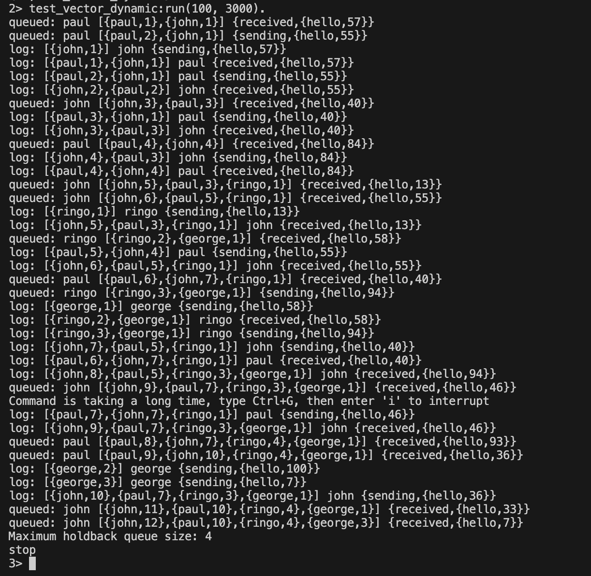

# Dynamic vector-clock test

`test_vector_dynamic:run(100, 3000)` starts John and Paul first, then starts Ringo and George one second later using the same vector-clock logger.

- maximum holdback queue size of 4. 
- Entries from the later workers appear in vectors at the original workers: 
    - for example John receives Ringo's message with a vector containing `{ringo,1}`.
    ```
    log: [{ringo,1}] ringo {sending,{hello,13}}
    log: [{john,5},{paul,3},{ringo,1}] john {received,{hello,13}}
    ```
    - This shows that the logger starts empty and learns new worker names from their log entries while preserving causal send-before-receive order.
- John and Paul cannot send messages to newly started workers because their peer lists are fixed at startup.




```
2> test_vector_dynamic:run(100, 3000).
queued: paul [{paul,1},{john,1}] {received,{hello,57}}
queued: paul [{paul,2},{john,1}] {sending,{hello,55}}
log: [{john,1}] john {sending,{hello,57}}
log: [{paul,1},{john,1}] paul {received,{hello,57}}
log: [{paul,2},{john,1}] paul {sending,{hello,55}}
log: [{john,2},{paul,2}] john {received,{hello,55}}
queued: john [{john,3},{paul,3}] {received,{hello,40}}
log: [{paul,3},{john,1}] paul {sending,{hello,40}}
log: [{john,3},{paul,3}] john {received,{hello,40}}
queued: paul [{paul,4},{john,4}] {received,{hello,84}}
log: [{john,4},{paul,3}] john {sending,{hello,84}}
log: [{paul,4},{john,4}] paul {received,{hello,84}}
queued: john [{john,5},{paul,3},{ringo,1}] {received,{hello,13}}
queued: john [{john,6},{paul,5},{ringo,1}] {received,{hello,55}}
log: [{ringo,1}] ringo {sending,{hello,13}}
log: [{john,5},{paul,3},{ringo,1}] john {received,{hello,13}}
queued: ringo [{ringo,2},{george,1}] {received,{hello,58}}
log: [{paul,5},{john,4}] paul {sending,{hello,55}}
log: [{john,6},{paul,5},{ringo,1}] john {received,{hello,55}}
queued: paul [{paul,6},{john,7},{ringo,1}] {received,{hello,40}}
queued: ringo [{ringo,3},{george,1}] {sending,{hello,94}}
log: [{george,1}] george {sending,{hello,58}}
log: [{ringo,2},{george,1}] ringo {received,{hello,58}}
log: [{ringo,3},{george,1}] ringo {sending,{hello,94}}
log: [{john,7},{paul,5},{ringo,1}] john {sending,{hello,40}}
log: [{paul,6},{john,7},{ringo,1}] paul {received,{hello,40}}
log: [{john,8},{paul,5},{ringo,3},{george,1}] john {received,{hello,94}}
queued: john [{john,9},{paul,7},{ringo,3},{george,1}] {received,{hello,46}}
Command is taking a long time, type Ctrl+G, then enter 'i' to interrupt
log: [{paul,7},{john,7},{ringo,1}] paul {sending,{hello,46}}
log: [{john,9},{paul,7},{ringo,3},{george,1}] john {received,{hello,46}}
queued: paul [{paul,8},{john,7},{ringo,4},{george,1}] {received,{hello,93}}
queued: paul [{paul,9},{john,10},{ringo,4},{george,1}] {received,{hello,36}}
log: [{george,2}] george {sending,{hello,100}}
log: [{george,3}] george {sending,{hello,7}}
log: [{john,10},{paul,7},{ringo,3},{george,1}] john {sending,{hello,36}}
queued: john [{john,11},{paul,10},{ringo,4},{george,1}] {received,{hello,33}}
queued: john [{john,12},{paul,10},{ringo,4},{george,3}] {received,{hello,7}}
Maximum holdback queue size: 4
stop
3> 
```