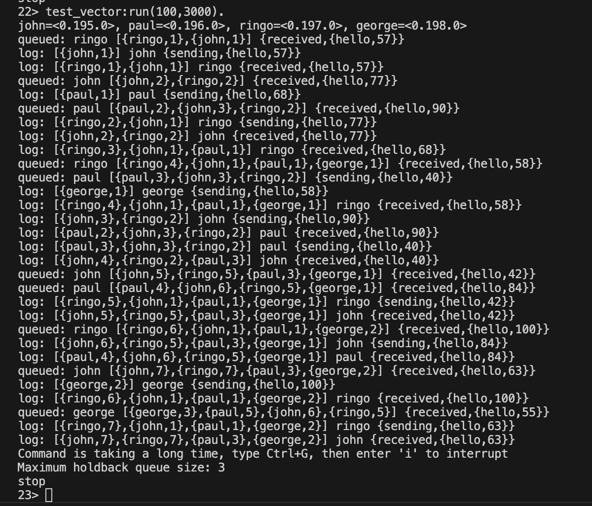

# Tests of Vector module

## Config: Sleep -> 100, Jitter -> 3000
```
22> test_vector:run(100,3000).
john=<0.195.0>, paul=<0.196.0>, ringo=<0.197.0>, george=<0.198.0>
queued: ringo [{ringo,1},{john,1}] {received,{hello,57}}
log: [{john,1}] john {sending,{hello,57}}
log: [{ringo,1},{john,1}] ringo {received,{hello,57}}
queued: john [{john,2},{ringo,2}] {received,{hello,77}}
log: [{paul,1}] paul {sending,{hello,68}}
queued: paul [{paul,2},{john,3},{ringo,2}] {received,{hello,90}}
log: [{ringo,2},{john,1}] ringo {sending,{hello,77}}
log: [{john,2},{ringo,2}] john {received,{hello,77}}
log: [{ringo,3},{john,1},{paul,1}] ringo {received,{hello,68}}
queued: ringo [{ringo,4},{john,1},{paul,1},{george,1}] {received,{hello,58}}
queued: paul [{paul,3},{john,3},{ringo,2}] {sending,{hello,40}}
log: [{george,1}] george {sending,{hello,58}}
log: [{ringo,4},{john,1},{paul,1},{george,1}] ringo {received,{hello,58}}
log: [{john,3},{ringo,2}] john {sending,{hello,90}}
log: [{paul,2},{john,3},{ringo,2}] paul {received,{hello,90}}
log: [{paul,3},{john,3},{ringo,2}] paul {sending,{hello,40}}
log: [{john,4},{ringo,2},{paul,3}] john {received,{hello,40}}
queued: john [{john,5},{ringo,5},{paul,3},{george,1}] {received,{hello,42}}
queued: paul [{paul,4},{john,6},{ringo,5},{george,1}] {received,{hello,84}}
log: [{ringo,5},{john,1},{paul,1},{george,1}] ringo {sending,{hello,42}}
log: [{john,5},{ringo,5},{paul,3},{george,1}] john {received,{hello,42}}
queued: ringo [{ringo,6},{john,1},{paul,1},{george,2}] {received,{hello,100}}
log: [{john,6},{ringo,5},{paul,3},{george,1}] john {sending,{hello,84}}
log: [{paul,4},{john,6},{ringo,5},{george,1}] paul {received,{hello,84}}
queued: john [{john,7},{ringo,7},{paul,3},{george,2}] {received,{hello,63}}
log: [{george,2}] george {sending,{hello,100}}
log: [{ringo,6},{john,1},{paul,1},{george,2}] ringo {received,{hello,100}}
queued: george [{george,3},{paul,5},{john,6},{ringo,5}] {received,{hello,55}}
log: [{ringo,7},{john,1},{paul,1},{george,2}] ringo {sending,{hello,63}}
log: [{john,7},{ringo,7},{paul,3},{george,2}] john {received,{hello,63}}
Command is taking a long time, type Ctrl+G, then enter 'i' to interrupt
Maximum holdback queue size: 3
stop
23>
```
### What is always true?

* For all events on the same process, `Vector(ei) <= Vector(ej)` (every entry of the first is less than or equal to the matching entry of the second, and the vectors are not equal) if event `ei` happened before event `ej` on that process.
    * Example: all of `ringo`'s printed events are ordered by `ringo`'s own entry, and each vector is also `>=` the previous one in every other entry, not just ringo's own. This holds in both directions on a single process (the reverse is true as well: if `X` happens before `Y` on the same process, `Vector(X) <= Vector(Y)`, and if `Vector(X) <= Vector(Y)` on the same process, `X` happened before `Y`).
* For message events (related) between two processes, if event `X` happened before event `Y`, then every entry of `Vector(X)` is `<=` the matching entry of `Vector(Y)`, and `Vector(X) != Vector(Y)`.
    * Example: the `sending` event of `john` (`[{john,1}]`) has every entry `<=` the matching entry of the `received` event of `ringo` (`[{ringo,1},{john,1}]`), because the `sending` event caused the `received` event. By transitivity, `john`'s `sending` event is also `<=` every later `ringo` event (e.g. `[{ringo,2},{john,1}]`).
* **Unlike Lamport counters**, the converse also holds for vector clocks across processes: if every entry of `Vector(X)` is `<=` the matching entry of `Vector(Y)` (and `X != Y`), then `X` happened before `Y`. This is the key advantage of vector clocks: the comparison is if-and-only-if, not one-directional.
    * Example: `[{paul,1}]` (paul sending 68) has every entry `<= [{ringo,3},{john,1},{paul,1}]` (ringo receiving 68), so we can directly conclude `paul`'s send happened before `ringo`'s receive, without needing to trace the message chain by hand.
* If two events `X` and `Y` in different processes have neither `Vector(X) <= Vector(Y)` nor `Vector(Y) <= Vector(X)`, the events are concurrent.
    * Example: `george`'s send (`[{george,1}]`) and `paul`'s send (`[{paul,1}]`): neither vector is entrywise `<=` the other, so they are concurrent (meaning one did not cause the other), and we know this directly from the vectors, with certainty, unlike with Lamport counters.

### What is sometimes true?

* Nothing is only "sometimes true" here in the way it was for Lamport counters — that was precisely the limitation vector clocks fix. With Lamport counters, `LamportCounter(X) < LamportCounter(Y)` was not enough to conclude `X` happened before `Y`. With vector clocks, every entry of `Vector(X)` being `<=` the matching entry of `Vector(Y)` (with `X != Y`) is **always** sufficient to conclude `X` happened before `Y`. There is no ambiguous case left to check by hand.

### How do we play it safe?

* Compare two vectors entry by entry. If every entry of one is `<=` the matching entry of the other (and they're not equal), the ordering is certain and there is no need to trace message chains or say "might be concurrent."
* If neither vector is entrywise `<=` the other, the events are concurrent (no event cause the other), with certainty and not just "no conclusion can be drawn," as was the case with Lamport counters.



